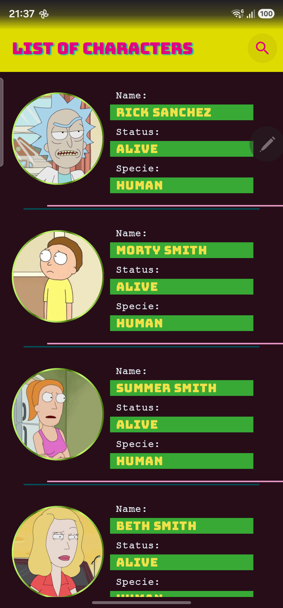
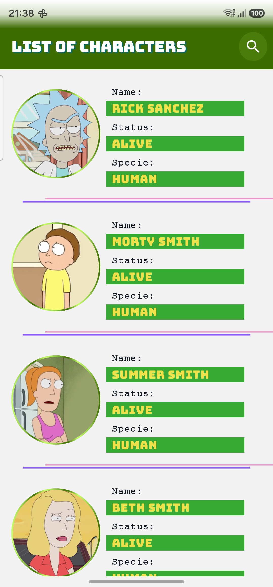
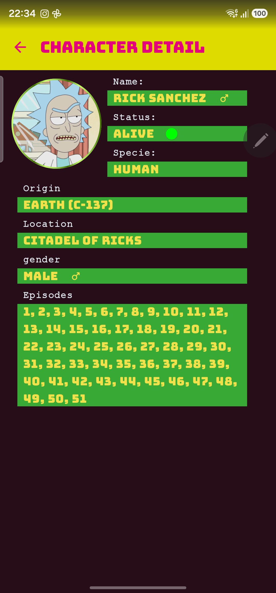
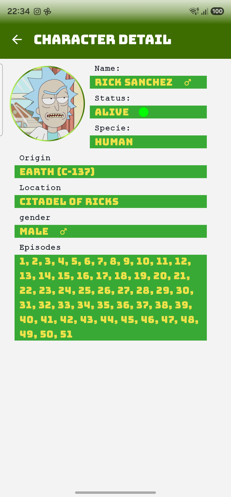

# 🥒 RickDex

[](https://kotlinlang.org)
[](https://developer.android.com/jetpack/compose)
[](https://developer.android.com/topic/architecture)
[](https://dagger.dev/hilt/)
[](https://developer.android.com/topic/libraries/data-store/index.html)
[](https://github.com/NiadeCode/RickDex/actions/workflows/android_ci.yml)
[](https://opensource.org/licenses/MIT)

---

[🇬🇧 English](#english) | [🇪🇸 Español](#español)

---

<a name="english"></a>
## 🇬🇧 English

### 📖 About the Project
**RickDex** is a native Android application built following industry-best practices and modern Android development tools (Jetpack Compose, Clean Architecture, Hilt, Room, and Paging 3). It lets users explore the vast universe of characters from the popular TV show *Rick and Morty* by consuming the official [Rick and Morty API](https://rickandmortyapi.com/), delivering a smooth user experience, modern styling, and full offline capabilities.

### ✨ Key Features
- **Paginated List with Offline Caching:** Built with Paging 3 and `RemoteMediator` backed by a local Room database, enabling seamless navigation and offline persistence.
- **Character Details:** Comprehensive detail screens displaying attributes such as status, species, gender, origin, location, and episodes.
- **Light & Dark Themes:** Fully supported light and dark modes inspired by the acid and vibrant color palette of the Rick and Morty universe.
- **Robust Network Management:** Uses Retrofit and OkHttp with a custom retry interceptor (`RateLimitRetryInterceptor`) to gracefully handle rate-limiting.
- **Clean Architecture:** Strict separation of concerns organized across three modules: `:app`, `:data`, and `:domain`.
- **Reactive State Management:** MVVM / MVI pattern leveraging Kotlin Coroutines and Flows (`StateFlow`, `SharedFlow`, `Intents`, `UiState`, and `Effects`).
- **Unit Testing:** Solid unit test coverage spanning across domain, data, and presentation layers.

### 🏛️ Project Architecture
The project strictly adheres to **Clean Architecture** principles:
- **`:domain`**: Pure Kotlin module with zero Android framework dependencies. Contains business models (`BO`), repository interfaces (`Repository`), and use cases (`UseCases`).
- **`:data`**: Data layer module. Implements repositories, mappers between DTOs, Room entities, and domain objects, along with local (Room) and remote (Retrofit / PagingSource / RemoteMediator) data sources.
- **`:app`**: Presentation module. Built entirely with **Jetpack Compose** and **Material 3**, utilizing Hilt for dependency injection and screen-level reactive architectures (ViewModels with Intents and UiState).

### 📱 Screenshots
<p align="center">
  
  
</p>
<p align="center">
  
  
</p>

### 🚀 Getting Started & Building
The project is designed to build out of the box upon cloning, requiring no external API keys (the Rick and Morty API is public).

1. Clone the repository:
   ```bash
   git clone https://github.com/NiadeCode/RickDex.git
   ```
2. Open the project in **Android Studio** (Koala or newer recommended).
3. Sync the project with Gradle files.
4. Run the app on your emulator or physical device (`./gradlew assembleDebug`).

> 💡 **CI/CD:** Automated builds and unit tests are configured via **GitHub Actions** (`.github/workflows/android_ci.yml`).

---

<a name="español"></a>
## 🇪🇸 Español

### 📖 Acerca del Proyecto
**RickDex** es una aplicación nativa para Android desarrollada con los estándares más altos de la industria y las tecnologías modernas de Android (Jetpack Compose, Clean Architecture, Hilt, Room y Paging 3). La aplicación permite explorar el vasto universo de personajes de la popular serie *Rick and Morty* consumiendo la [Rick and Morty API](https://rickandmortyapi.com/), ofreciendo una experiencia fluida, diseño moderno y soporte offline completo.

### ✨ Características Principales
- **Listado Paginado con Caché Offline:** Implementado con Paging 3 y `RemoteMediator` respaldado por una base de datos local Room, permitiendo navegación fluida y funcionamiento sin conexión.
- **Detalle de Personajes:** Pantallas detalladas con información completa sobre cada personaje (estado, especie, género, origen, ubicación y episodios).
- **Temas Claro y Oscuro:** Soporte completo para modos claro y oscuro inspirados en la paleta de colores ácidos y vibrantes de la serie.
- **Manejo Robusto de Red:** Uso de Retrofit y OkHttp junto con un interceptor personalizado (`RateLimitRetryInterceptor`) para gestionar y reintentar solicitudes limitadas por tasa (Rate Limit).
- **Arquitectura Limpia (Clean Architecture):** Separación estricta de responsabilidades dividida en tres módulos: `:app`, `:data` y `:domain`.
- **Gestión de Estado Reactiva:** Patrón MVVM / MVI basado en Flujos (`StateFlow`, `SharedFlow`, `Intents`, `UiState` y `Effects`).
- **Pruebas Unitarias:** Cobertura de pruebas unitarias robustas en la capa de dominio, datos y presentación.

### 🏛️ Arquitectura del Proyecto
El proyecto sigue rigurosamente los principios de **Clean Architecture**:
- **`:domain`**: Módulo puro de Kotlin libre de dependencias de Android. Contiene los modelos de negocio (`BO`), contratos de repositorios (`Repository`) y los casos de uso (`UseCases`).
- **`:data`**: Módulo responsable de la fuente de datos. Implementa los repositorios, mapeadores entre DTOs, entidades de Room y objetos de negocio, orígenes de datos locales (Room) y remotos (Retrofit / PagingSource / RemoteMediator).
- **`:app`**: Módulo de la interfaz de usuario. Construido íntegramente con **Jetpack Compose** y **Material 3**, utilizando Hilt para la inyección de dependencias y arquitecturas reactivas por pantalla (ViewModels con Intents y UiState).

### 📱 Capturas de Pantalla
<p align="center">
  
  
</p>
<p align="center">
  
  
</p>

### 🚀 Primeros Pasos y Ejecución
El proyecto está configurado para compilar directamente al clonar el repositorio, sin requerir claves de API adicionales (la API de Rick and Morty es pública).

1. Clona el repositorio:
   ```bash
   git clone https://github.com/NiadeCode/RickDex.git
   ```
2. Abre el proyecto en **Android Studio** (Koala o superior recomendado).
3. Sincroniza el proyecto con Gradle.
4. Ejecuta la aplicación en tu emulador o dispositivo físico (`./gradlew assembleDebug`).

> 💡 **CI/CD:** La integración continua para compilación automática y ejecución de pruebas unitarias está configurada mediante **GitHub Actions** (`.github/workflows/android_ci.yml`).

---

## 👤 Author & Contact / Autor y Contacto

**Joaquín Ruiz Ramírez** (NiadeCode)

- GitHub: [@NiadeCode](https://github.com/NiadeCode)
- LinkedIn: [Joaquín Ruiz Ramírez](https://www.linkedin.com/in/joaquín-ruiz-a1137616b/)

---

## 📝 License / Licencia

This project is licensed under the **MIT License** - see the [LICENSE](LICENSE) file for details.
